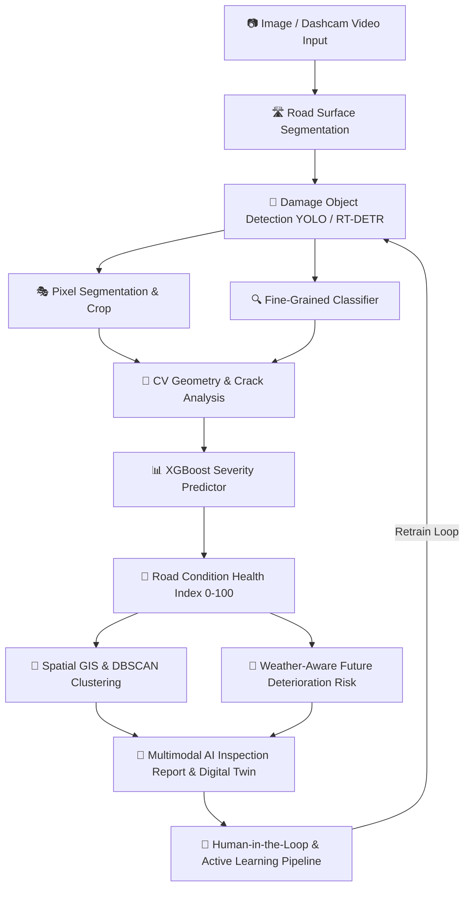

# 🛣️ RoadVision AI - ML Intelligence Engine

> **Autonomous AI-Powered Road Damage Detection, Pixel Segmentation, Geo-Spatial GIS Clustering & Predictive Maintenance System.**

[](https://www.python.org/)
[](https://fastapi.tiangolo.com/)
[](https://github.com/ultralytics/ultralytics)
[](https://xgboost.readthedocs.io/)
[](#)

---

## 📌 Executive Summary

**RoadVision AI ML Core** is an enterprise-grade Computer Vision and Predictive Intelligence suite for automated road condition inspection, severity prediction, spatial GIS clustering, and deterioration forecasting. Designed to plug seamlessly into web/mobile frontends and backend services.

---

## 🏗️ System Architecture



---

## 🏆 Implemented ML Capabilities (3 Phases)

### Phase 1 — Mandatory Core ML
1. **Multi-Class Damage Detection**: Potholes, Cracks, Alligator cracks, Longitudinal cracks, Transverse cracks, Rutting, Patches, Depressions, Edge damage.
2. **Damage Segmentation**: Exact pixel mask extraction & road area vs damaged surface area coverage ratio (`m²`).
3. **Fine-Grained Classification**: EfficientNet / ResNet / ConvNeXt classification.
4. **Computer Vision Measurement**: Length (`m`), Width (`m`), Area (`m²`), Crack skeletonization, Crack density (`%`), Depth estimation interface.
5. **Severity Prediction**: XGBoost / LightGBM ensemble classifier outputting `LOW`, `MEDIUM`, `HIGH`, `CRITICAL`.
6. **Road Condition Health Score**: 0–100 Road Health Index per segment.

### Phase 2 — Advanced AI
7. **Video Object Tracking & Duplicate Removal**: ByteTrack / DeepSORT tracking across sequential frames.
8. **Spatial GIS Clustering**: DBSCAN / HDBSCAN clustering nearby damages (50–100m) into *High Damage Clusters* with GeoJSON output.
9. **Infrastructure & Obstruction Detection**: Manholes, speed breakers, zebra crossings, barricades, debris, open manholes.
10. **Traffic Density Estimation**: Vehicle counting (Cars, Bikes, Buses, Trucks) to calculate road load exposure.
11. **Lane Marking Analysis**: Evaluates condition (Normal, Faded, Broken, Missing).
12. **Flood / Waterlogging Detection**: Surface reflectivity & water risk classification.

### Phase 3 — High/Research-Level ML
13. **Weather-Aware Predictive Damage Risk**: 30-day & 90-day deterioration failure forecasts.
14. **Maintenance Decision-Support & Priority Model**: Assigns intervention actions (Patch, Resurface, Major Repair) and priority ranking (`URGENT`, `HIGH`, `MEDIUM`, `LOW`).
15. **Explainable AI (XAI)**: SHAP feature attributions & Grad-CAM visual heatmaps.
16. **Human-in-the-Loop & Active Learning**: Uncertainty sampling boundary (45%–65%), human correction queue, automated retrain trigger.
17. **Road Digital Twin & Spatio-Temporal Graph Model**: Complete temporal AI profile per road segment.
18. **Multimodal Inspection Report Generator**: Structured JSON + Executive Natural Language Summary + Markdown Report.

---

## ⚡ Quick Start & Installation

```bash
git clone https://github.com/2k25cse2510041-beep/RoadDamage-Detection-GIS.git
cd RoadDamage-Detection-GIS
pip install -r requirements.txt

# Run Instant End-to-End Demo
python demo_run.py

# Launch FastAPI Web Server
uvicorn api.app:app --reload --port 8000
```
